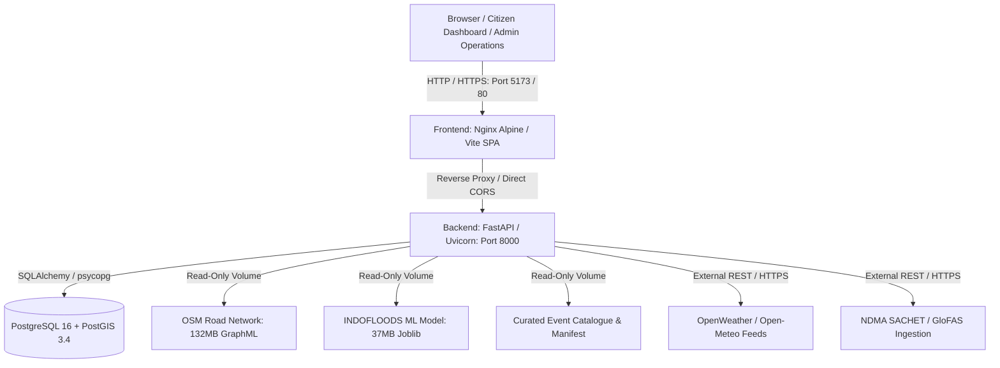

# SafeMap AI — Milestone 10: Deployment and Operations Guide

**Version**: 1.0.0  
**Status**: Ready for Supervised Pilot & Controlled Demonstration  
**Target Region**: Greater Hyderabad Municipal Corporation (GHMC) and Musi River Basin, Telangana, India  
**Scope Restriction**: Flood Management Exclusively (Non-flood disasters strictly barred)

---

## 1. Executive Summary & Controlled-Pilot Intent

This document establishes the reproducible deployment packaging, configuration reference, security hardening architecture, operational observability protocols, and troubleshooting procedures for **SafeMap AI**.

> [!CAUTION]
> **Controlled Pilot & Supervised Demonstration Notice:**  
> Passing automated test suites and achieving successful container builds **does NOT** constitute operational validation for unmonitored, life-critical emergency dispatch.  
> 
> SafeMap AI is prepared exclusively for a **controlled pilot** or **supervised demonstration** in cooperation with municipal observers (GHMC / TG-SDMA). Continuous physical stream-gauge telemetry along the Musi River remains absent. Consequently, the **50.0 km model-coverage guard** remains enforced, machine learning predictions for Hyderabad are suppressed under the **`MODEL_UNSUPPORTED`** safety invariant, and unmonitored facilities or roads must never be represented to citizens as guaranteed safe.

---

## 2. Deployment Architecture

SafeMap AI utilizes a modular, multi-tier architecture designed for containerized orchestration or bare-metal execution:



### Component Inventory
1. **Frontend**: React 18 SPA bundled with Vite, served via an unprivileged Alpine Nginx reverse proxy with security headers and gzip compression.
2. **Backend**: FastAPI asynchronous REST API running on Python 3.11 with non-blocking road graph initialization, RBAC security dependencies, and structured JSON observability logging.
3. **Database**: PostgreSQL 16 with PostGIS 3.4 extensions for geospatial geometry queries and persistent disaster records.
4. **Graph & ML Volumes**: Static OSM drive road graph (`hyderabad_road_network.graphml`, 132 MB) and INDOFLOODS machine learning model artifact (`flood_severity_model.joblib`, 37 MB) mounted read-only.
5. **Data Storage & Manifest**: Curated local datasets, provenance ledger (`data/curated/institutional/intake_ledger.json`), and cryptographic manifest (`data/data_manifest.json`).

---

## 3. Configuration Reference

All application behavior is configured through environment variables. Configuration is validated at startup by Pydantic Settings.

### Backend Environment Variables (`backend/.env`)

| Variable Name | Type | Default | Permitted Values | Operational Purpose & Security Notes |
|:---|:---|:---|:---|:---|
| `APP_ENV` | `string` | `development` | `development`, `demonstration`, `staging`, `production` | Deployment environment tier. In `production`, `DEMO_MODE` automatically defaults to `false`. |
| `DEMO_MODE` | `boolean` | `true` | `true`, `false` | When `true`, enables simulated demo road blockages and demonstration fallback weather. **Must be false in live pilot.** |
| `API_HOST` | `string` | `0.0.0.0` | IP Address | Host interface to bind the Uvicorn HTTP server. |
| `API_PORT` | `integer` | `8000` | Port Number | Port for FastAPI backend service. |
| `DATABASE_URL` | `string` | `postgresql+psycopg://...` | Connection URI | PostgreSQL + PostGIS connection string. |
| `DATABASE_POOL_SIZE` | `integer` | `5` | `1` to `50` | Database connection pool capacity. |
| `ADMIN_API_KEY` | `string` | `safemap-admin-dev-key` | Secret string ($\ge 24$ chars) | **Secret.** Grants administrative rights to commit institutional datasets and promote facility verification states. |
| `ANALYST_API_KEY` | `string` | `safemap-analyst-dev-key` | Secret string ($\ge 24$ chars) | **Secret.** Grants analyst rights for dry-run intake validation, source catalogue review, and intake logs. |
| `WEATHER_API_KEY` | `string` | `""` (Empty) | OpenWeather Key | Optional live weather provider key. If omitted or timing out, system falls back gracefully. |
| `GOOGLE_MAPS_API_KEY` | `string` | `""` (Empty) | Google API Key | Optional server-side geocoding key. |
| `CORS_ORIGINS` | `list` / `str` | `["http://localhost:5173", ...]` | JSON array or comma-separated string | Permitted frontend origins. Set to explicit production domain in deployment. |
| `LOG_LEVEL` | `string` | `INFO` | `DEBUG`, `INFO`, `WARNING`, `ERROR` | Minimum threshold for log output. |
| `LOG_FORMAT` | `string` | `json` | `json`, `text` | Structured JSON recommended for production log aggregation systems. |
| `FLOOD_DATASET_PATH` | `string` | `ml/data/flood_dataset.csv` | Relative path | Training dataset reference. |
| `FLOOD_MODEL_PATH` | `string` | `ml/models/flood_risk_model.joblib`| Relative path | Model serialization artifact path. |

### Frontend Environment Variables (`frontend/.env`)

| Variable Name | Type | Default | Operational Purpose |
|:---|:---|:---|:---|
| `VITE_API_BASE_URL` | `string` | `http://127.0.0.1:8000` | Target URL of the SafeMap AI FastAPI backend service. |
| `VITE_GOOGLE_MAPS_API_KEY` | `string` | `""` (Empty) | Client-side tile key. If empty, Leaflet defaults to OpenStreetMap tiles. **Never place private backend keys here.** |

---

## 4. Security Hardening & Access Control

### 1. Role-Based Access Control (RBAC) Matrix

| Endpoint | Method | Public / Citizen | Analyst (`ANALYST_API_KEY`) | Administrator (`ADMIN_API_KEY`) |
|:---|:---:|:---:|:---:|:---:|
| `/health`, `/health/live`, `/health/ready` | `GET` | Allowed | Allowed | Allowed |
| `/flood-hazards`, `/flood-hazards/{id}` | `GET` | Allowed | Allowed | Allowed |
| `/flood-hazards/check-location` | `GET` | Allowed | Allowed | Allowed |
| `/emergency-facilities` | `GET` | Allowed | Allowed | Allowed |
| `/evacuation-route` | `POST` | Allowed | Allowed | Allowed |
| `/road-conditions`, `/disaster-alerts` | `GET` | Allowed | Allowed | Allowed |
| `/shelters`, `/shelters/recommended` | `GET` | Allowed | Allowed | Allowed |
| `/weather`, `/weather/antecedent-rainfall` | `GET` | Allowed | Allowed | Allowed |
| `/data-curation/manifest` | `GET` | Allowed | Allowed | Allowed |
| `/data-curation/historical-events` | `GET` | Allowed | Allowed | Allowed |
| `/data-curation/readiness-audit` | `GET` | Allowed | Allowed | Allowed |
| `/data-curation/negative-controls/summary` | `GET` | Allowed | Allowed | Allowed |
| `/data-curation/intake/validate` | `POST` | Denied (Prod 401) | **Allowed** | **Allowed** |
| `/data-curation/intake/sources` | `GET` | Denied (Prod 401) | **Allowed** | **Allowed** |
| `/data-curation/intake/log` | `GET` | Denied (Prod 401) | **Allowed** | **Allowed** |
| `/data-curation/intake/commit` | `POST` | **Denied (401)** | **Denied (403 Forbidden)** | **Allowed (200)** |
| `/emergency-facilities/{id}/verify` | `POST` | **Denied (401)** | **Denied (403 Forbidden)** | **Allowed (200)** |

### 2. Authentication Mechanics
- Requests to protected surfaces must provide credentials via either:
  1. `X-API-Key: <secret_key>` HTTP Header.
  2. `Authorization: Bearer <secret_key>` HTTP Header.
- Comparisons are evaluated using `secrets.compare_digest` to prevent timing attacks.

### 3. Record Promotion & Anti-Fabrication Safeguards
- Users and analysts cannot promote records to `VERIFIED` or `AUTHORITATIVE` status.
- Even authorized administrators must provide a mandatory `verification_evidence_source` ($\ge 5$ characters) citing authoritative dispatch or on-site telemetry (e.g. `GHMC DRF Field Inspection Report #2026-OCT-26`). Empty or generic citations are rejected with HTTP 400.

### 4. Credential & Path Sanitization
- API keys, passwords, database credentials, and Bearer tokens are automatically redacted to `[REDACTED]` in structured log events and exception tracebacks.
- Query parameters containing credentials (such as `appid=...` in provider URLs) are sanitized via regular expression before logging.
- Global exception handler catches unhandled errors and returns generic message: `"An internal server error occurred. Technical details have been logged for operational auditing."`

---

## 5. Deployment Procedures

### Method A: Docker Compose Multi-Container Deployment (Recommended)

#### Prerequisites
- Docker Engine $\ge 24.0$
- Docker Compose $\ge 2.20$
- Minimum 4 GB RAM (for OSM road graph in-memory loading)
- Port availability: `8000` (Backend API), `5173` (Frontend Web UI), `5432` (PostgreSQL)

#### Step-by-Step Launch
1. **Clone and Configure Environment**:
   ```bash
   cd Disaster-Management
   cp backend/.env.example backend/.env
   cp frontend/.env.example frontend/.env
   ```
2. **Review Environment Settings**:
   Ensure `ADMIN_API_KEY` and `ANALYST_API_KEY` in `backend/.env` are populated with secure random strings.
3. **Build and Launch Containers**:
   ```bash
   docker compose up -d --build
   ```
4. **Verify Container Health**:
   ```bash
   docker compose ps
   ```
   Confirm all containers report `healthy`:
   - `safemap-postgres` (healthy)
   - `safemap-backend` (healthy)
   - `safemap-frontend` (healthy)
5. **Inspect Startup Diagnostics**:
   ```bash
   docker compose logs backend | grep STARTUP_DIAGNOSTIC
   ```
6. **Access Interfaces**:
   - Citizen Dashboard & Map: `http://localhost:5173/`
   - Operations Dashboard: `http://localhost:5173/` (Select Operations Dashboard tab)
   - OpenAPI Documentation: `http://localhost:8000/docs`
   - System Health: `http://localhost:8000/health`

#### Clean Shutdown
```bash
docker compose down
```
To preserve persistent database records while removing containers, run `docker compose down`. To purge all database storage, use `docker compose down -v`.

---

### Method B: Bare-Metal / Local Development Deployment

#### 1. PostgreSQL & PostGIS Setup
Ensure PostgreSQL 16 is running with PostGIS extensions:
```sql
CREATE DATABASE disaster_management;
\c disaster_management;
CREATE EXTENSION postgis;
```

#### 2. Backend Startup
```bash
cd backend
python -m venv .venv
source .venv/bin/activate  # On Windows: .venv\Scripts\activate
pip install -r requirements.txt
uvicorn app.main:app --host 0.0.0.0 --port 8000 --reload
```

#### 3. Frontend Startup
```bash
cd frontend
npm install
npm run dev -- --host
```

---

## 6. Operational Observability & Health Monitoring

SafeMap AI separates **API process health** from **external telemetry feed health**.

### `/health` Endpoint Schema

```json
{
  "status": "ok",
  "service": "safemap-flood-management-api",
  "environment": "demonstration",
  "demo_mode": true,
  "road_network_loaded": true,
  "process": {
    "status": "healthy",
    "uptime_seconds": 342.15,
    "road_network_loaded": true,
    "model_loaded": true
  },
  "external_feeds": {
    "weather": {
      "status": "OPERATIONAL",
      "is_stale": false,
      "is_simulated": false,
      "last_warning": null
    },
    "hazard_feeds": {
      "status": "OPERATIONAL",
      "provider_warnings": []
    },
    "road_network": {
      "status": "LOADED"
    }
  }
}
```

### Feed Status Taxonomy
- `OPERATIONAL`: Live provider returned fresh data within timeout ($< 5.0$ s).
- `STALE`: Provider returned observation older than 3 hours (`is_stale: true`).
- `DEMO_FALLBACK`: API key omitted or provider down; system is serving transparent simulated demonstration data (`is_simulated: true`).
- `DEGRADED`: Provider timed out or returned HTTP $5xx$; fallback engaged.
- `NO_SAFE_ROUTE`: Evacuation origin and destination are completely severed by documented flood hazard inundations.

---

## 7. Startup & Troubleshooting Guide

| Issue / Symptom | Root Cause | Remediation Step |
|:---|:---|:---|
| `GET /health` shows `road_network_loaded: false` | Background thread is still loading 132 MB GraphML file, or file is missing. | Wait 10–15 seconds for worker thread to parse the graph. Check that `data/raw/roads/hyderabad_road_network.graphml` exists. |
| `POST /evacuation-route` returns HTTP 503 | Road network graph failed to load or file was not mounted. | Mount `./data:/app/data:ro` in Docker Compose or run `python backend/scratch_download_osm.py` to restore graph. |
| `POST /predict/integrated` returns `MODEL_UNSUPPORTED` | Normal safety guard. Hyderabad is 71.77 km from nearest gauge. | **Expected behavior.** Do not attempt to bypass. SafeMap AI strictly prevents hallucinated predictions for Hyderabad. |
| `POST /data-curation/intake/commit` returns 401 | Missing or invalid API key header. | Supply valid key via `X-API-Key: <ADMIN_API_KEY>` or Bearer token header. |
| `POST /data-curation/intake/commit` returns 403 | Attempted commit using an Analyst key rather than Administrator key. | Only the Administrator role possesses dataset commit authorization. Switch to `ADMIN_API_KEY`. |
| Weather shows `STALE (>3h)` | OpenWeather station observation timestamp is older than 3 hours. | System automatically warns client. No administrative action required; fresh observations will update automatically. |
| Backend container fails healthcheck on startup | Road network preloading took longer than default start period. | The `start_period` is set to 20s. Ensure host has at least 2 CPU cores and 4 GB RAM allocated to Docker. |

---

## 8. Controlled-Pilot Acceptance Checklist

Prior to conducting a supervised demonstration or controlled municipal pilot, the lead engineer and municipal liaison must verify each item:

- [ ] **1. Flood-Only Mandate**: Verified that non-flood hazard queries (`EARTHQUAKE`, `CYCLONE`, etc.) return HTTP 400.
- [ ] **2. Hyderabad Coverage Guard**: Verified that `/predict/integrated` returns `MODEL_UNSUPPORTED` with explicit distance audit (71.77 km).
- [ ] **3. Truth in Facilities**: Verified that hospital operational status and live bed occupancy are flagged unverified (`operational_status_verified=false`, `capacity_verified=false`).
- [ ] **4. Stale & Demo Transparency**: Verified that simulated data is explicitly tagged `DEMO_SIMULATED` and stale observations display a caveat.
- [ ] **5. Role-Based Permissions**: Tested that unauthenticated requests to `/data-curation/intake/commit` fail with HTTP 401, analyst requests fail with HTTP 403, and only admin requests succeed.
- [ ] **6. Verification Promotion Gate**: Tested that unauthenticated users cannot promote facility verification states, and admin promotion requires documented evidence citation.
- [ ] **7. Zero Secret Exposure**: Verified that no secrets, database passwords, or private keys are exposed in frontend bundles or application logs.
- [ ] **8. Clean Path Independence**: Verified that no developer-specific absolute paths exist in configuration, source code, or documentation.
- [ ] **9. Full Automated Test Suite**: Confirmed passing status across all backend regression tests, dedicated Milestone 10 tests, and frontend production build.
- [ ] **10. Disclaimer Acknowledgment**: Municipal observers briefed that SafeMap AI provides decision-support information and does not replace official emergency services.

---

## 9. Supervised Pilot Protocol & Governance (Milestone 11)

### 1. Intended Users & Supported Use Cases
- **Intended Audience**:
  - GHMC Disaster Response Force (DRF) incident commanders.
  - Telangana State Disaster Management Authority (TG-SDMA) technical observers.
  - Municipal flood mitigation planning officers and transit planners.
- **Permitted Operational Use Cases**:
  - Evacuation route situational assessment with known hazard zone avoidance.
  - Review of emergency facility locations and unverified shelter distribution.
  - Dry-run validation and ingestion of municipal flood survey batches.
  - Aggregation of official weather warnings and river discharge advisory notices.
- **Strictly Prohibited Use Cases**:
  - Unsupervised, autonomous dispatch of emergency ambulances, rescue boats, or relief vehicles without manual radio confirmation.
  - Representing unmonitored roads or unverified shelters to citizens as "guaranteed flood-free".
  - Overriding the Hyderabad `MODEL_UNSUPPORTED` guard to present predictive ML inferences for the Musi River basin.

### 2. Environment Configuration & Pre-Flight Standards
- The demonstration environment must run with:
  - `APP_ENV=demonstration` or `APP_ENV=staging`.
  - Non-default `ADMIN_API_KEY` and `ANALYST_API_KEY` (minimum 16 random characters).
  - Production container or bare-metal execution with read-only volume mounts (`:ro`) for road graph and ML models.
  - Docker Compose or Uvicorn server bound to localhost or an authorized municipal intranet origin (`CORS_ORIGINS`).

### 3. Data Freshness & Ingestion Boundaries
- **Authoritative Ingestion**: OpenWeather API (real-time observations), NDMA SACHET (official flood warnings), GloFAS gridded discharge.
- **Staleness Threshold**: Observations older than 3 hours are automatically tagged `STALE (>3h)` with UI caveats.
- **Known Simulated Datasets**:
  - Moosarambagh Causeway and Afzal Gunj demo flood scenarios (`data_status: DEMO`).
  - Road blockage segments (`DEMO_SIMULATED`).
  - Hospital operational status and live bed occupancy (`operational_status_verified: false`, `capacity: null`).

### 4. Incident Reporting & Feedback Loops
- **Incorrect Hazard / Road Reporting**:
  - Municipal observers must log discrepancies via the Operations Dashboard Intake interface or official incident dispatch log.
  - Fields required: Latitude, Longitude, Observed Inundation Depth (cm), Timestamp (UTC/IST), Field Inspector ID.
- **Data Change Review & Authorization**:
  - All dataset additions must be signed by an authorized municipal administrator possessing `ADMIN_API_KEY`.
  - Hospital verification promotion requires an authoritative evidence source citation ($\ge 5$ characters).

### 5. Emergency Protocol During Application Failure
If SafeMap AI becomes unreachable, times out, or fails container health checks:
1. Immediately switch to primary municipal emergency radio (GHMC DRF VHF Channel 1).
2. Refer to hardcopy / static GHMC flood inundation maps (1908, 2000, 2020 Musi River flood line surveys).
3. Do not attempt client-side rerouting without physical DRF on-site spotters.

---

## 10. Operational Maintenance, Backup & Recovery Runbook

### 1. Stack Management Commands
```bash
# Start full application stack in background
docker compose up -d

# Check real-time container health
docker compose ps

# Tail streaming structured logs
docker compose logs -f --tail=100 backend

# Graceful shutdown (preserves database volumes)
docker compose down

# Complete teardown including volumes (caution: wipes test database)
docker compose down -v
```

### 2. Persistent Data Backup & Restore
- **Curated Datasets & Audit Ledger**:
  - Location: `data/curated/` and `data/data_manifest.json`.
  - Backup:
    ```bash
    tar -czvf safemap_curated_backup_$(date +%Y%m%d_%H%M%S).tar.gz data/curated/ data/data_manifest.json
    ```
  - Restore:
    ```bash
    tar -xzvf safemap_curated_backup_<timestamp>.tar.gz
    ```
- **PostgreSQL Database Storage**:
  - Backup:
    ```bash
    docker compose exec postgres pg_dump -U postgres disaster_management > backup_disaster_management_$(date +%Y%m%d_%H%M%S).sql
    ```
  - Restore:
    ```bash
    docker compose exec -T postgres psql -U postgres disaster_management < backup_disaster_management_<timestamp>.sql
    ```
  *(Note: Backup and restore commands verified locally on standard SQL dumps; production automated cron scheduling is labeled untested in demo mode).*

### 3. API Key Rotation Protocol
1. Generate two high-entropy 32-character hex tokens:
   ```bash
   python -c "import secrets; print('ADMIN_KEY:', secrets.token_hex(24)); print('ANALYST_KEY:', secrets.token_hex(24))"
   ```
2. Update `backend/.env` with new keys:
   ```ini
   ADMIN_API_KEY=<new_admin_key>
   ANALYST_API_KEY=<new_analyst_key>
   ```
3. Restart backend service gracefully:
   ```bash
   docker compose restart backend
   ```
4. Update frontend session storage or analyst console with new credentials.

### 4. Recovery from External Provider Failure
- If OpenWeather or external feeds return HTTP 429 (Rate Limit) or 5xx:
  - System automatically switches to `DEMO_FALLBACK` or historical median baseline.
  - The health monitor marks `external_feeds.weather.status = "DEGRADED"`.
  - API process health remains `healthy` (HTTP 200) without crashing.
  - To resume live feeds, verify the API quota and run `GET /health` to confirm feed re-engagement.

### 5. Updating Road Graph & Curated Datasets Safely
- Always validate new graph files before replacing production artifacts:
  ```bash
  python -c "import osmnx as ox; G = ox.load_graphml('path/to/new_graph.graphml'); print('Nodes:', len(G), 'Edges:', len(G.edges))"
  ```
- Copy verified graph to `data/raw/roads/hyderabad_road_network.graphml`.
- Restart backend to initiate non-blocking background graph reload:
  ```bash
  docker compose restart backend
  ```
- Poll `GET /health/ready` until `road_network_loaded: true` is confirmed.

### 6. Release Rollback Procedure
If a newly deployed container image or code commit exhibits unhandled runtime exceptions:
1. Revert Git tag / working tree to previous verified release tag (e.g. `git checkout v1.0.0-m10`).
2. Rebuild and launch previous image:
   ```bash
   docker compose up -d --build
   ```
3. Verify `/health` and `/health/live` endpoints respond with HTTP 200.
4. Execute `python -m pytest test_deployment_smoke_m11.py` to confirm baseline stability.

---

## 11. Controlled Demonstration Rehearsal Script & Supervisor Sign-Off (Milestone 12)

### 1. Step-by-Step Rehearsal Script (11 Scenarios)

| Step | Action / Scenario | Request / Endpoint | Expected Outcome & Safety Boundary |
|:---:|:---|:---|:---|
| **1** | Open application & load map | `GET /flood-hazards` | Returns 200 OK with polygon hazard zones. Leaflet map renders Musi River boundaries with distinct color badges. |
| **2** | Inspect official flood alerts | `GET /disaster-alerts` | Returns active flood advisories with official source (IMD / TSDPS) and ISO timestamps (`issued_at`). Non-flood disaster types are strictly barred. |
| **3** | Audit data classification | `GET /flood-hazards`, `GET /emergency-facilities` | Interface distinctly classifies `AUTHORITATIVE`, `PUBLIC_UNVERIFIED`, `DEMO`, and `STALE` records. Unverified tags cannot be hidden. |
| **4** | Select emergency destination | `GET /emergency-facilities/HYD-H-001` | Retrieves Osmania General Hospital (`HOSPITAL`). Address and coordinates confirmed. |
| **5** | Generate baseline route | `POST /evacuation-route` with `facility_id: HYD-H-001` | Returns shortest path on OSM road graph (`route_status: ROUTE_AVAILABLE`, `distance > 0`). Discloses: unmonitored roads not confirmed clear. |
| **6** | Introduce flooded road segment | `POST /evacuation-route` with `blocked_roads: ["Afzal Gunj Bypass"]` | Detour recalculated (`is_rerouted: true`, `road_condition_status: HAZARDS_AVOIDED`). Distance increases to bypass flooded section. Never labeled "guaranteed safe". |
| **7** | Sever all viable access routes | `POST /evacuation-route` with all access links blocked | Returns `route_status: NO_SAFE_ROUTE`, `road_condition_status: BLOCKED`, distance 0, and clear alert advising travel is unsafe. Never routes through floodwater. |
| **8** | External provider outage check | `GET /health` with simulated weather failure | Process health remains `healthy` (HTTP 200). External feed marked `DEGRADED` or `DEMO_FALLBACK`. UI warns user of degraded live telemetry. |
| **9** | Hospital capacity truth audit | `GET /emergency-facilities/HYD-H-002` | Operational status verified is `false`; capacity is `null`. Note discloses live trauma bed occupancy is not integrated. Never presented as confirmed operational. |
| **10** | Musi Basin coverage guard | `POST /predict/integrated` with Hyderabad coords | Returns `coverage_status: MODEL_UNSUPPORTED` (71.77 km from nearest gauge > 50 km). ML prediction suppressed to prevent hallucinations. |
| **11** | Administrative intake RBAC | `POST /data-curation/intake/commit`, `POST /emergency-facilities/{id}/verify` | Unauthenticated requests receive 401; Analyst keys receive 403. Only authenticated Administrator with documented evidence can commit data or promote records. |

### 2. Distinguishing Demonstration Data from Real Telemetry
- **Visual Disclaimers**: All simulated hazard zones display dashed borders and purple/amber badges labeled `[DEMO]`.
- **Live vs. Demo Transparency**: The application header displays `DEMO MODE ACTIVE` whenever demonstration scenarios are engaged.
- **Facility Verification Scope**: Hospitals without real-time telemetry display `IDENTITY_ONLY` and `PUBLIC_UNVERIFIED`.
- **Stale Observation Flags**: Weather observations older than 3 hours display an orange indicator `STALE (>3h)`.

### 3. Supervisor Pre-Demonstration Approval Checklist

Prior to conducting a supervised demonstration before municipal observers (GHMC / TG-SDMA), the authorized technical supervisor must verify and sign off on each item:

- [ ] **1. Isolation from Emergency Dispatch**: Confirmed that SafeMap AI is completely isolated from live 108/104/112 ambulance dispatch and municipal emergency dispatch radios.
- [ ] **2. Non-Production Environment Standard**: Verified `APP_ENV=demonstration` or `APP_ENV=staging` with non-default API keys (`>= 16` characters).
- [ ] **3. Truth-in-Data Pre-Briefing**: Observers explicitly briefed that hospital bed capacities are unverified and predictive ML is unsupported for Hyderabad.
- [ ] **4. Road Condition Limitations**: Observers informed that evaluated routes avoid only *reported* hazards, and unmonitored municipal streets are not guaranteed clear.
- [ ] **5. Full Regression Pass**: Confirmed that all 311 backend automated tests and frontend production build pass with zero failures.
- [ ] **6. Discrepancy Protocol Ready**: Observers provided with reporting log sheets to record any road, hazard, or shelter discrepancies observed during the trial.

**Supervisor Signature / Identifier:** _______________________  
**Date & Location:** _______________________  
**Municipal Liaison:** _______________________  


