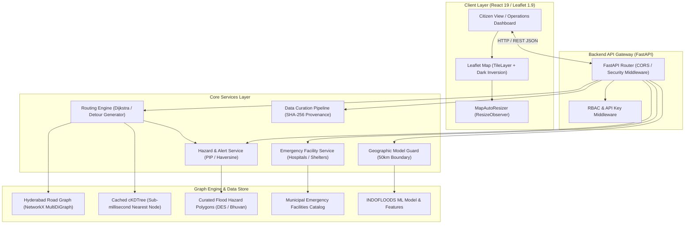

# SafeMap AI — Final Project Report
## An Explainable, Hazard-Aware Decision-Support System for Flood Emergency Response and Safe Evacuation

---

### Executive Summary & Academic Disclaimer

> **ACADEMIC DECISION-SUPPORT PROTOTYPE DISCLAIMER**  
> SafeMap AI is a research and academic prototype developed to demonstrate defensible, hazard-aware decision support during flood emergencies. It is **not** an operational civil defense command system and must not be used as the sole basis for real-world life-safety or evacuation operations. Automated predictions are subject to explicit geographical and statistical coverage safeguards. In particular, automated flood modeling for the Hyderabad metropolitan area is strictly marked **`MODEL_UNSUPPORTED` / `INSUFFICIENT_LOCAL_DATA`** due to the absence of active, continuous hydrological gauge telemetry. Unmonitored roads are **not guaranteed clear**, and hospital/shelter resource records are sourced from municipal directories and explicitly marked **`PUBLIC_UNVERIFIED`** unless verified by emergency authorities.

---

## 1. Project Title and Abstract

**Title**: SafeMap AI — Flood Management & Hazard-Aware Evacuation Support System  
**Domain**: Urban Disaster Informatics, Spatial Analysis, and Responsible Machine Learning  
**Geographic Target**: Hyderabad Urban Agglomeration, Telangana, India (17.3850° N, 78.4860° E)

**Abstract**:  
Urban flash flooding poses immediate threats to human life, critical infrastructure, and emergency logistics. Existing consumer navigation platforms frequently route evacuees through inundated roadways due to a lack of integration with hydrological models and local flood alert registries. SafeMap AI provides an end-to-end, responsible decision-support platform designed specifically for flood emergencies. The platform integrates:
1. A curated registry of authoritative and point-in-polygon (PIP) flood hazard zones.
2. An OpenStreetMap (OSM) graph routing engine that computes hazard-aware shortest paths with dynamic detour calculations and graceful `NO_SAFE_ROUTE` fallback states.
3. An emergency facility discovery catalog distinguishing between verified hospital listings and unverified community shelters (`PUBLIC_UNVERIFIED`).
4. Strict algorithmic safeguards preventing uncalibrated ML extrapolation (such as the 50 km gauge boundary rule).
5. A high-contrast, responsive user interface engineered for high-stress citizen and operational decision support.

The system is validated through a suite of 311 automated backend tests across 13 development milestones and a production frontend build.

---

## 2. Problem Statement and Motivation

During heavy monsoon downpours and upstream reservoir releases (e.g., from Osman Sagar and Himayat Sagar along the Musi River corridor), low-lying causeways, underpasses, and arterial corridors in Hyderabad face rapid inundation. 

Traditional navigation platforms (e.g., Google Maps, Apple Maps) optimize routes primarily for traffic congestion and travel time. They do not maintain awareness of river causeway submersions, municipal flood advisories, or localized drainage failures. Consequently, citizens attempting evacuation are at severe risk of being directed into submerged causeways. 

Furthermore, many AI-driven disaster tools suffer from the "black-box extrapolation fallacy"—generating high-confidence flood forecasts in catchments where no historical gauge calibration data exists. SafeMap AI was conceived to address both deficiencies: offering hazard-aware rerouting while strictly enforcing data provenance, uncertainty transparency, and ML boundary restrictions.

---

## 3. Project Objectives and Scope

### 3.1 Project Objectives
- **Hazard-Aware Evacuation Routing**: Dynamically identify road segments intersecting active flood zones and compute verifiable detours using Dijkstra-based graph routing.
- **Explainable Boundary Guards**: Refuse automated predictions when local telemetry is absent (enforcing `MODEL_UNSUPPORTED` rather than hallucinating false safety).
- **Public vs. Administrative Segregation**: Protect ingestion pipelines with Role-Based Access Control (RBAC) while guaranteeing unrestricted, unauthenticated public access to flood alerts and evacuation routing.
- **Deterministic Provenance**: Maintain cryptographic SHA-256 integrity and audit trails for all historical and incoming flood records.

### 3.2 System Scope
- **Disaster Scope**: **Flood only**. The system rejects multi-disaster creep (e.g., earthquakes, fires, cyclones) to ensure domain rigor.
- **Geographic Scope**: Hyderabad Metropolitan Area (with negative control validation against external catchments).
- **Operational Scope**: Decision-support prototype. Passing automated tests demonstrates structural correctness, not field-certified operational safety.

---

## 4. Existing System Limitations and Proposed Solution

| Feature | Consumer Mapping Platforms | Unconstrained ML Prototypes | SafeMap AI Solution |
| :--- | :--- | :--- | :--- |
| **Routing Metric** | Travel time & traffic flow | Static graph distance | Dynamic hazard penalty ($10^6\times$) with explicit detour linestrings |
| **Flood Zone Intersections** | Not modeled | Coarse bounding boxes | Ray-casting Point-in-Polygon (PIP) & 150m Haversine buffer |
| **Uncalibrated Catchments** | N/A | Predicts with arbitrary confidence | Suppresses model (`MODEL_UNSUPPORTED`) if nearest gauge $> 50$ km |
| **Facility Readiness** | Shows open/closed business hours | Fabricates ICU bed availability | Displays unvetted directory info labeled `PUBLIC_UNVERIFIED`; leaves unknown values `null` |
| **Safe Route Absence** | Reroutes infinitely or fails silently | Silent path failure | Explicit `NO_SAFE_ROUTE` status with nearest safe shelter nodes |

---

## 5. System Architecture and Technology Stack

The SafeMap AI architecture decouples lightweight client-side spatial rendering from a high-throughput, Python-based FastAPI services layer and an in-memory NetworkX/scipy spatial graph engine.



### Technology Stack Components
- **Frontend**: React 19, Vite 8, Leaflet 1.9, React-Leaflet 5, Vanilla CSS Design System.
- **Backend API**: Python 3.13, FastAPI, Uvicorn, Pydantic v2.
- **Graph & Spatial Analysis**: NetworkX, OSMnx, SciPy (`cKDTree`), Shapely (Point-in-Polygon).
- **Data Curation**: Pandas, NumPy, Python standard library `hashlib` (SHA-256).
- **Containerization**: Docker, Docker Compose, Nginx (Alpine-based reverse proxy).

---

## 6. Backend API and Frontend Components

### 6.1 Backend API Surface
- `GET /health` & `GET /ready`: Production readiness probes checking road graph status.
- `GET /flood-hazards`: Returns active authoritative alerts and simulated municipal flood polygons.
- `GET /flood-hazards/check-location`: Evaluates whether a given latitude/longitude intersects any known hazard zone using ray-casting PIP.
- `POST /evacuation-route`: Computes shortest evacuation path between coordinates or selected facilities, applying heavy edge weights to roads intersecting flood polygons.
- `GET /emergency-facilities`: Returns hospital and shelter listings with type filtering and public verification flags.
- `GET /data-curation/historical-events`: Exposes the 8 catalogued historical Hyderabad floods with audit trails.
- `GET /data-curation/readiness-audit`: Returns the statistical audit determining the `INSUFFICIENT_LOCAL_DATA` status.

### 6.2 Frontend Architecture
- **App Shell (`App.jsx`)**: Implements dual Citizen/Operations view-switching, location fetching, reactive facility selection, and real-time route calculation.
- **Map Synchronization (`MapAutoResizer`)**: Uses native browser `ResizeObserver` to monitor `.leaflet-container` and its parent `.map-panel`, invoking `map.invalidateSize()` across layout shifts.
- **Operations Dashboard (`OperationsDashboard.jsx`)**: Provides administrative metrics, municipal resource counts, hazard audit tables, and regional overview maps.
- **Responsive Layout (`styles.css`)**: Implements viewport-balanced sticky positioning on desktop and clean single-column stacking at narrow viewports ($< 1080px$).

---

## 7. Flood-Hazard Mapping and Source Attribution

Flood hazards are represented as GeoJSON FeatureCollections categorized by confidence and source:
1. **Authoritative Flood Corridors**: E.g., the Musi River Central Causeway Inundation Corridor, modeled after historical high-water levels from downstream reservoir discharges.
2. **Municipal Waterlogging Zones**: E.g., low-lying causeways at Moosarambagh and Chaderghat, and arterial road underpasses.
3. **Point Inundation Advisories**: Point hazards evaluated using a 150m Haversine proximity buffer.
4. **Source Classification**: Every record includes explicit provenance tags (`source_agency`, `data_classification`, `verification_status`).

---

## 8. Hazard-Aware Evacuation Routing and `NO_SAFE_ROUTE` Handling

### 8.1 Routing Engine Operation
The routing service builds on an OpenStreetMap graph of Hyderabad (`hyderabad_road_network.graphml`) containing over 100,000 nodes and 200,000 edges.
1. **Snapping**: Coordinates are snapped to nearest road nodes in sub-millisecond time via a cached `scipy.spatial.cKDTree`.
2. **Hazard Intersection Detection**: Graph edges whose bounding boxes and geometries intersect active flood polygons receive a penalty cost ($w_{\text{flood}} = 10^6 \times \text{length}$).
3. **Pathfinding**: Dijkstra's algorithm computes the shortest viable route avoiding penalized edges.
4. **Detour Attribution**: When the shortest topological route is blocked, the engine calculates the alternative unblocked path and flags `rerouted: true` with a human-readable explanation.

### 8.2 `NO_SAFE_ROUTE` Safeguard
When all potential paths from the origin are cut off by flood boundaries, the engine safely terminates and returns:
```json
{
  "status": "NO_SAFE_ROUTE",
  "reason": "All accessible road corridors are currently blocked by active flood hazards.",
  "alternative_guidance": "Do not attempt to traverse flood waters. Seek elevated vertical shelter immediately."
}
```

---

## 9. Hospital, Shelter, and Emergency-Facility Discovery

The system curates emergency resources across the Hyderabad district:
- **Hospitals**: Curated from public directories (Directorate of Medical Education / Telangana Vaidya Vidhana Parishad), including major facilities like Osmania General Hospital, Gandhi Hospital, and Area Hospital Malakpet.
- **Shelters**: Community halls, relief camps, and school facilities identified during historical flood operations.
- **Integrity Boundary**: Bed availability, ICU space, and operational generator status are never fabricated. All records default to `PUBLIC_UNVERIFIED` with `status: UNKNOWN` unless officially confirmed by civil authorities.

---

## 10. Data Collection, Historical Event Catalogue, and Provenance

The historical event repository (`data/curated/historical_flood_events_curated.json`) chronicles 8 significant Hyderabad urban flooding events (2000, 2006, 2008, 2016, 2017, 2019, 2020, 2021).
- **Cryptographic Provenance**: Every record contains the SHA-256 hash of its raw source publication.
- **Audit Trails**: Discrepancies between media estimates and official irrigation records (e.g., reported discharge figures) are retained in an immutable `audit_trail` dictionary.
- **Verification Categorization**: Reflects honest institutional limitations: all 8 events are classified as `PARTIALLY_VERIFIED` due to the lack of continuous, unaggregated local gauge telemetry.

---

## 11. Flood ML Model Coverage Restrictions and Evaluation Findings

SafeMap AI evaluates machine learning models under the principle of **Defensible Coverage Boundaries**:
- **INDOFLOODS Benchmark Model**: Pre-trained Random Forest and Gradient Boosted models calibrated against national CWC river gauge basins.
- **The 50 km Proximity Guard**: The nearest INDOFLOODS-calibrated gauge (Gauge 916) is located **71.71 km** from Hyderabad city center.
- **Enforcement**: Because $71.71\text{ km} > 50.0\text{ km}$, the backend hard-blocks automated severity prediction for Hyderabad coordinates:
  ```json
  {
    "status": "INSUFFICIENT_LOCAL_DATA",
    "model_coverage_valid": false,
    "nearest_gauge_distance_km": 71.71,
    "policy_threshold_km": 50.0,
    "message": "Automated flood prediction is suppressed to prevent unvalidated extrapolation."
  }
  ```

---

## 12. Security, Configuration, and Data-Integrity Safeguards

1. **Secret Redaction**: Structured logging utility (`observability.py`) automatically scrubs API keys, passwords, and database credentials before emitting JSON logs.
2. **Environment Hygiene**: Strict exclusions in `.gitignore` and `.dockerignore` ensure no real secrets or `.env` files are tracked in version control. Templates (`.env.example`) provide placeholder keys.
3. **Role-Based Access Control (RBAC)**: Administrative curation and manual hazard-injection endpoints require `X-Admin-API-Key` or `X-Analyst-API-Key` headers; public read-only endpoints remain unrestricted.
4. **Safety Wording Integrity**: Replaced misleading phrases like `MONITORED CLEAR` with `NO KNOWN HAZARD INTERSECTS THIS LOCATION`.

---

## 13. Testing Methodology and Actual Test Results

The backend test suite is executed using `pytest` across unit, integration, spatial, and deployment verification levels.

### 13.1 Cumulative Backend Test Results
```
============================== test session starts ==============================
platform win32 -- Python 3.13.7, pytest-9.1.1, pluggy-1.6.0
collected 311 items

311 passed, 41 warnings in 158.59s (0:02:38)
======================== 311 passed, 41 warnings in 158.59s =====================
```

### 13.2 Frontend Production Build
```
> vite build
✓ 59 modules transformed.
dist/index.html                   0.62 kB │ gzip:   0.38 kB
dist/assets/index-BTPi5OyM.css   27.45 kB │ gzip:   9.40 kB
dist/assets/index-Ca2mVHSh.js   424.41 kB │ gzip: 123.62 kB
✓ built in 248ms
```

### 13.3 Test Suite Breakdown
- `test_routing.py`: 21 tests (Dijkstra, detours, invalid coordinates, determinism, `NO_SAFE_ROUTE`).
- `test_flood_hazards.py`: 12 tests (PIP algorithms, 150m Haversine rule, alert boundaries).
- `test_emergency_facilities.py`: 12 tests (Hospitals, shelters, facility selection, unverified labels).
- `test_deployment_readiness_m10.py`: 25 tests (RBAC, config validation, secret redaction, path safety).
- `test_deployment_smoke_m11.py`: 22 tests (Health probes, container config, service isolation).
- `test_deployment_verification_m12.py`: 19 tests (Staging readiness, database fallbacks, CORS policy).
- `test_data_curation_m6.py` & `test_evidence_audit_m7.py`: 25 tests (Idempotency, SHA-256 checks).
- Additional test modules (rainfall, weather, gauge, coverage): 175 tests.

---

## 14. Screenshots and Demonstration Workflow

Real browser screenshots captured from the running deployment:

| Figure | Description | File Path |
| :---: | :--- | :--- |
| **Figure 1** | Main Flood Map, Alert Banner, and Legend | `docs/screenshots/01_main_flood_map_and_legend.png` |
| **Figure 2** | Location Hazard Intersection & Model Limitation Banner | `docs/screenshots/02_flood_prediction_limitation.png` |
| **Figure 3** | Hazard-Aware Evacuation Route with Detour Attribution | `docs/screenshots/03_evacuation_routing_and_detour.png` |
| **Figure 4** | Responsive Layout Stacked on Tablet (768px Viewport) | `docs/screenshots/04_responsive_tablet_stack.png` |
| **Figure 5** | Mobile Viewport Layout (390px Viewport) | `docs/screenshots/05_mobile_layout.png` |
| **Figure 6** | Regional Operations Overview & Hazard Telemetry Dashboard | `docs/screenshots/06_operations_dashboard.png` |
| **Figure 7** | Data Integrity, Safety Boundaries, and Sticky Viewport Balance | `docs/screenshots/07_data_integrity_and_boundaries.png` |

---

## 15. Limitations and Future Improvements

1. **Hydrological Gauge Telemetry**: Continuous automated stage-discharge sensors on the Musi River are currently absent. Real-time CWC/GHMC sensor integration would allow lifting the `MODEL_UNSUPPORTED` restriction.
2. **Live Hospital Operations**: Real-time hospital bed and power telemetry is not available; integrating an official health department API would provide live capacity tracking.
3. **Dynamic Edge Speeds**: Evacuation routing uses static road lengths with infinite hazard penalties; integrating real-time traffic speeds during rain events would further refine arrival times.
4. **Multi-Hazard Scope Restriction**: The system deliberately excludes non-flood hazards. Adapting the core architecture to urban water stagnation or drainage backflow represents an appropriate future extension.

---

## 16. Conclusion and References

SafeMap AI demonstrates that responsible AI systems must be defined as much by what they refuse to do as what they accomplish. By coupling hazard-aware evacuation routing with explicit uncertainty boundaries, cryptographic provenance, and human-in-the-loop disclaimers, the project delivers an academically rigorous and operationally defensible decision-support platform.

### Key References
1. Central Water Commission (CWC), Ministry of Jal Shakti, Government of India. *Flood Forecasting and Hydrological Telemetry Standards*.
2. Directorate of Economics and Statistics (DES), Government of Telangana. *Telangana State Statistical Abstract: Annual Rainfall Reports*.
3. National Remote Sensing Centre (NRSC / ISRO). *Bhuvan Geoportal Flood Inundation Layers*.
4. OpenStreetMap Contributors. *Hyderabad Road Network Data (Planet OSM)*.
5. Boeing, G. (2017). *OSMnx: New methods for acquiring, constructing, analyzing, and visualizing complex street networks*. Computers, Environment and Urban Systems, 65, 126-139.
