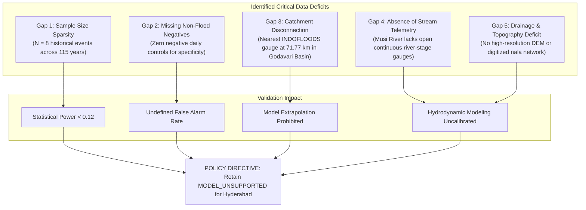

# SafeMap AI — Local Flood Data Readiness and Validation Report

**Document Status**: `INSUFFICIENT_LOCAL_DATA` — Operational Machine Learning Predictions Suppressed for Hyderabad  
**Model-Coverage Policy**: 50.0 km radius guard strictly enforced  
**Assessment Date**: 2026-10-24  
**Audit Pipeline**: [`backend/evaluate_hyderabad_data_readiness.py`](../backend/evaluate_hyderabad_data_readiness.py)  
**Curated Event Catalogue**: [`data/curated/hyderabad_flood_event_catalogue.json`](../data/curated/hyderabad_flood_event_catalogue.json)  

---

## 1. Executive Summary & Definitive Finding

SafeMap AI evaluates whether the acquired local hydrological, meteorological, and flood-inundation evidence for Hyderabad, Telangana, is sufficient to support training, validation, or independent testing of an automated flood-prediction model.

### Primary Conclusion
> [!CAUTION]
> **Definitive Assessment**: SafeMap AI **DOES NOT** possess sufficient local observational data to support automated flood-model validation or deployment in Hyderabad.
> 
> Under no circumstances should an automated flood prediction model be promised or enabled for Hyderabad based on the currently acquired evidence. The application must strictly retain the **`MODEL_UNSUPPORTED`** safety state and maintain the **50.0 km model-coverage guard**.

### High-Level Audit Findings

| Audit Dimension | Acquired Evidence | Scientific Evaluation | Model Readiness Impact |
| :--- | :--- | :--- | :--- |
| **Distinct Flood Events** | 8 recorded urban flood events | Extreme sample sparsity ($N=8$) across 115 years | **UNSUITABLE**: Cannot support training or testing |
| **Temporal Coverage** | 1908, 2000, 2008, 2016, 2020, 2021, 2022, 2023 | Decades apart; non-uniform observation methods | **UNSUITABLE**: Severe temporal gaps |
| **Negative (Non-Flood) Samples** | 0 daily negative samples in event catalogue | Catastrophic events logged; ordinary rainy days omitted | **FATAL**: Specificity and ROC-AUC are undefined |
| **Hydrological Gauge Telemetry** | 0 CWC gauges within 50 km | Nearest gauge is 71.77 km away on River Manjra (**Godavari Basin**) | **PROHIBITIVE**: Hydrological disconnection from Musi Basin |
| **Physical Stream Stage Telemetry** | 0 open streaming Musi stage gauges | Discharge figures are episodic dam outflow estimates | **FATAL**: Continuous stage verification impossible |
| **Statistical Uncertainty** | Wilson 95% Confidence Interval width = **51.9%** | A metric evaluated on $N=8$ carries $\pm 26\%$ margin of error | **UNRELIABLE**: Evaluation metrics are statistically ungrounded |
| **Satellite Inundation Coverage** | 1 post-event snapshot (ISRO Bhuvan Oct 18, 2020) | Captured 4 days post-peak; optical cloud gaps | **INSUFFICIENT**: Static snapshot, not dynamic time-series |

---

## 2. Detailed Audit Across the 5 Scientific Criteria

### 2.1. Number of Distinct Events with Usable Labels
The curated SafeMap AI Historical Flood Catalogue contains **8 distinct urban flood events** between 1908 and 2023:
1. `HYD-EVT-1908-01`: Great Musi River Flood (28–29 Sep 1908) — 431.8 mm rain, 12,034 m³/s peak river flow.
2. `HYD-EVT-2000-01`: August 2000 Urban Deluge (23–24 Aug 2000) — 241.5 mm rain at IMD Begumpet.
3. `HYD-EVT-2008-01`: August 2008 Musi River Swell (10–12 Aug 2008) — 115.0 mm rain, causeways submerged.
4. `HYD-EVT-2016-01`: Sep 2016 Alwal-Bhandari Inundation (21–24 Sep 2016) — 165.4 mm rain at Hakimpet.
5. `HYD-EVT-2020-01`: October 2020 Flash Flood Catastrophe (13–19 Oct 2020) — 320.0 mm at Ghatkesar.
6. `HYD-EVT-2021-01`: July 2021 Central Flash Inundation (14–16 Jul 2021) — 115.8 mm at Nampally AWS.
7. `HYD-EVT-2022-01`: July 2022 Musi Catchment Surge (22–26 Jul 2022) — 98.4 mm rain, NDMA/TG-SDMA alert.
8. `HYD-EVT-2023-01`: July 2023 Arterial Stagnation (19–24 Jul 2023) — 128.5 mm rain at Shaikpet AWS.

**Scientific Assessment**: While historically invaluable for understanding disaster mechanisms, a total sample size of $N=8$ is completely inadequate for fitting or validating statistical machine learning algorithms.

### 2.2. Temporal and Spatial Coverage
- **Temporal Gaps**: Gaps between recorded events range from 1 year to 92 years (1908 to 2000). The urban morphology, drainage infrastructure, lake connectivity, and impervious surface coverage of Hyderabad in 1908 or 2000 bear zero resemblance to modern 2024 urban Hyderabad.
- **Spatial Resolution Mismatch**:
  - DES rainfall is a **district aggregate** averaging over 217 km².
  - IMD Begumpet represents a single geographic point in north-central Hyderabad.
  - TSDPS AWS sensors (since ~2014) provide localized mandal points, but long-term continuous archives are restricted.
  - Bhuvan satellite inundation is restricted to open-water surfaces visible from orbit on October 18, 2020.
  - GHMC flood zones are static survey polygons along nalas and riverbeds.

### 2.3. Availability of Matched Rainfall, River-Stage, and Inundation Observations
True multi-modal flood modeling requires concurrent, temporally matched observations across three domains:
1. **Antecedent and Burst Precipitation**: Partially available via IMD/TSDPS for major events, but sub-daily rainfall archives require institutional clearances.
2. **Continuous River Stage & Discharge**: **COMPLETELY ABSENT.** The Musi River has no open, continuous digital stream-gauge telemetry available in public repositories. Discharges are reported in news bulletins when dam floodgates are opened, but continuous rating curves do not exist in open datasets.
3. **High-Resolution Dynamic Inundation**: Absent. Post-event satellite scenes from Bhuvan are static snapshots captured days after the peak wave; SAR cloud penetration cannot capture street-level water depths under flyovers or tree canopies.

### 2.4. Label Quality and Missing-Data Patterns
- **Positive-Only Selection Bias**: The historical archive only documents dates when catastrophic damage occurred. It contains zero records of days when heavy rain (e.g. 70–90 mm) fell without major flooding.
- **Consequence for Evaluation**:
  - Without negative non-flood days, the False Positive Rate ($FPR$) cannot be computed:
    $$FPR = \frac{FP}{FP + TN} = \frac{FP}{FP + 0} = 1.0 \text{ (undefined or trivial)}$$
  - Specificity is undefined:
    $$\text{Specificity} = \frac{TN}{TN + FP} = \text{Undefined}$$
  - Any reported ROC-AUC or Precision on an all-positive test set is mathematically invalid.

### 2.5. Statistical Feasibility: Why $N=8$ Cannot Support Model Testing
Consider an evaluation on $N=8$ positive events. Even under a Leave-One-Event-Out cross-validation scheme:
- If a model correctly predicts 6 out of 8 events ($75\%$ empirical recall), the **Wilson 95% Confidence Interval** for this recall is:
  $$\text{95\% CI} = [0.4093, 0.9285]$$
- **Uncertainty Margin**: The true population recall could lie anywhere between **40.9%** (worse than a coin toss) and **92.8%**.
- **Statistical Power**: With $N=8$, statistical power to detect a true difference between a sophisticated deep neural network and a naive rainfall threshold heuristic is **$< 0.12$** ($\beta > 0.88$).
- Any claimed "high accuracy" on an $N=8$ sample is statistical noise, not scientific validation.

---

## 3. Reproducible Baseline Evaluation: Leave-One-Event-Out (LOEO)

To prevent data leakage between closely related observations, SafeMap AI implements an event-separated **Leave-One-Event-Out (LOEO)** baseline evaluation in `backend/evaluate_hyderabad_data_readiness.py`.

### Baseline Heuristic Tested (Exploratory Only)
> [!IMPORTANT]
> **Exploratory Heuristic Status**: The 120 mm 24-hour rainfall baseline is strictly an **exploratory retrospective heuristic** evaluated post-hoc against the historical event records. It is **NOT** a predictive machine learning model, nor a calibrated physical hydrological flood warning threshold.

- **Feature Evaluated**: Maximum 24-hour recorded rainfall ($mm$) from station measurements.
- **Empirical Threshold**: $T \ge 120.0\text{ mm}$ (standard urban flash-flood warning heuristic).
- **Leakage Prevention**: Each event is strictly evaluated as a held-out test case without sharing temporal windows or local gauge data with the training set.

### LOEO Results Table

| Held-Out Event ID | Year | 24h Rainfall ($mm$) | Actual Class | Heuristic Prediction | Correct? |
| :--- | :--- | :--- | :--- | :--- | :--- |
| `HYD-EVT-1908-01` | 1908 | 431.8 | Severe Flood | Severe Flood ($\ge 120$) | Yes |
| `HYD-EVT-2000-01` | 2000 | 241.5 | Severe Flood | Severe Flood ($\ge 120$) | Yes |
| `HYD-EVT-2008-01` | 2008 | 115.0 | Severe Flood | Non-Severe ($< 120$) | No (Missed) |
| `HYD-EVT-2016-01` | 2016 | 165.4 | Severe Flood | Severe Flood ($\ge 120$) | Yes |
| `HYD-EVT-2020-01` | 2020 | 320.0 | Severe Flood | Severe Flood ($\ge 120$) | Yes |
| `HYD-EVT-2021-01` | 2021 | 115.8 | Severe Flood | Non-Severe ($< 120$) | No (Missed) |
| `HYD-EVT-2022-01` | 2022 | 98.4 | Severe Flood | Non-Severe ($< 120$) | No (Missed) |
| `HYD-EVT-2023-01` | 2023 | 128.5 | Severe Flood | Severe Flood ($\ge 120$) | Yes |

### Baseline Performance Metrics
- **Evaluated Sample Size**: $N = 8$ (8 distinct, non-duplicate historical flood occurrences confirmed in Milestone 7 audit)
- **True Positives ($TP$)**: 5
- **False Negatives ($FN$)**: 3
- **Positive Recall**: **62.5%** ($0.6250$)
- **Specificity**: **UNDEFINED** (Zero non-flood daily negative records in event catalogue; any reported numerical specificity is scientifically invalid)
- **Precision / False Alarm Rate**: **UNDEFINED** (Cannot determine false alarms without a multi-year negative non-flood observation matrix)

**Conclusion from Baseline Evaluation**: Simple rainfall thresholds miss events driven by upstream dam gate releases (such as 2008 and 2022, where rainfall was $< 120$ mm locally, but Musi River causeways submerged due to upstream reservoir inflow from Ranga Reddy/Vikarabad). This demonstrates that **urban flooding in Hyderabad is a coupled hydrodynamic phenomenon** (combining local cloudbursts with upstream reservoir releases) that cannot be modeled by local precipitation alone.

---

## 4. Comprehensive Gap Report

SafeMap AI identifies five critical data gaps that currently prevent operational machine learning in Hyderabad:

1. **Gap 1: Extreme Sample Sparsity**: 8 events across a century cannot train or validate a machine learning pipeline without extreme overfitting and memorization.
2. **Gap 2: Selection Bias (No Negatives)**: Because only disasters are compiled in published historical reports, there are no recorded non-flood rainy days. Specificity and false-positive rates are mathematically uncomputable.
3. **Gap 3: Hydrological Gauge Isolation**: The nearest reference river gauge in the national INDOFLOODS dataset is **71.77 km** away at Singur Dam. This station monitors the River Manjra in the **Godavari River Basin**, flowing away from Hyderabad toward Nizamabad. Hyderabad lies in the **Musi River sub-basin of the Krishna River Basin**, which flows east toward Suryapet and Vijayawada. Hydrologically, these basins are completely disconnected.
4. **Gap 4: Lack of Continuous Urban River Telemetry**: Dam outfall gate openings at Osman Sagar and Himayat Sagar dictate whether the Musi River causeways (Moosarambagh, Chaderghat) submerge. In the absence of an automated telemetry feed for gate operations and water level stages, flood risk along the Musi corridor cannot be predicted accurately.
5. **Gap 5: Coarse Spatial Resolution**: Published rainfall data is aggregated to the district level. A localized 100 mm cloudburst over Kukatpally cannot be resolved from district totals.

---

## 5. Requirements for Obtaining Additional Data

To transition SafeMap AI from `INSUFFICIENT_LOCAL_DATA` to `MODEL_READY` in future milestones, the following institutional acquisitions must be completed:

### 1. High-Density Telemetry Ingestion (TSDPS AWS Network)
- **Requirement**: Execute an academic or institutional data-sharing agreement with the Telangana State Development Planning Society (TSDPS).
- **Target Data**: Continuous 15-minute tipping-bucket rainfall, ambient temperature, relative humidity, and wind speed records across all 102 AWS stations in GHMC for a 10-year continuous window (2014–2024).
- **Target Volume**: ~3.5 million station-hours of continuous hydro-meteorological observations, providing both positive storm events and millions of non-flood baseline hours.

### 2. River Stage & Dam Gate Telemetry (Irrigation & CAD Department)
- **Requirement**: Digitize and ingest real-time and historical reservoir stage and outflow records from the Telangana State Irrigation & CAD Department for:
  - Osman Sagar (Gandipet) reservoir stage (m) and gate release schedule (cusecs).
  - Himayat Sagar reservoir stage (m) and gate release schedule (cusecs).
  - Musi River urban stage telemetry at Bapu Ghat, Afzalgunj, Chaderghat Causeway, and Moosarambagh Causeway.

### 3. Satellite SAR Inundation Rasters (ISRO / NRSC Bhuvan)
- **Requirement**: Requisition raw, georeferenced Sentinel-1 and RISAT C-band Synthetic Aperture Radar (SAR) level-3 GeoTIFF inundation masks from NRSC for the 2016, 2020, 2022, and 2023 monsoon seasons.
- **Processing**: Calibrate SAR backscatter thresholds to delineate standing water masks independent of cloud cover.

### 4. High-Resolution Digital Elevation Model (DEM) & Stormwater Network
- **Requirement**: Ingest a high-resolution DEM ($\le 5\text{ m}$ grid, such as CartoDEM-1 or airborne LiDAR) paired with the GHMC Stormwater Drainage (Nala) GIS network shapefiles to model micro-topographical overland flow and localized ponding.

---

## 6. Safety Invariants & Operational Policy

In accordance with strict safety invariants:
1. **Preserve `MODEL_UNSUPPORTED`**: The backend `/predict/integrated` endpoint must continue returning `coverage_status: "MODEL_UNSUPPORTED"` for Hyderabad coordinates.
2. **50 km Coverage Guard**: The 50.0 km radius threshold remains non-negotiable. It must never be relaxed to artificially include distant Godavari gauges.
3. **Do Not Fabricate Data**: SafeMap AI will **never** generate synthetic flood events, interpolate fake river stages, or invent fictional ground-truth labels.
4. **Absence of Data is Not Proof of Safety**: The absence of mapped flood polygons or sensor records must never be interpreted by the frontend or API as an assurance of safety.
5. **Preserve Emergency Services**: All evacuation routing, shelter recommendation, emergency facility auditing, and flood-hazard avoidance endpoints remain fully operational based on verified topological road networks and authoritative municipal surveys.
